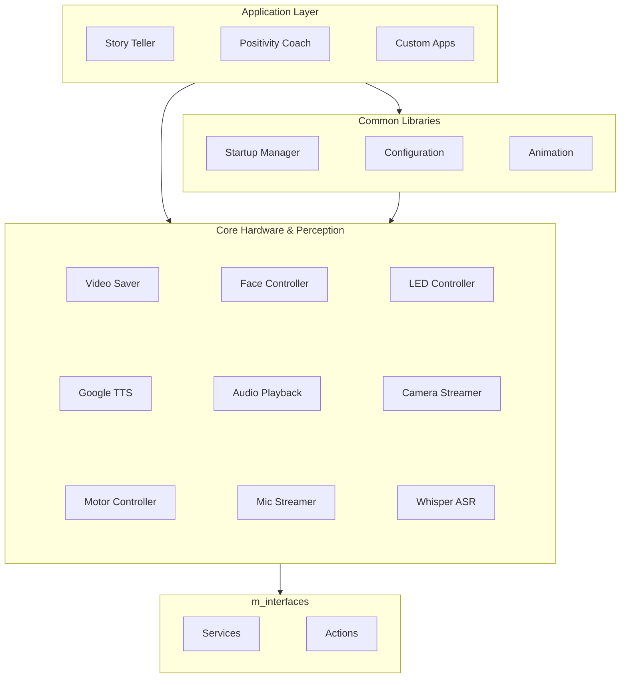

# Architecture Overview

The M Platform follows a layered ROS 2 architecture that cleanly separates hardware interfaces, perception pipelines, shared utilities, and application-level orchestration.

## System Layers

## Layer Descriptions

### Core Hardware & Perception

Low-level nodes that directly interface with robot hardware:

- **Motor Control** — `motor_controller` node exposes `SetPose`, `PlayPoseSequence`, and `ExecutePrimitive` services for joint control
- **Audio Pipeline** — `mic_streamer` publishes raw audio; `faster_whisper_asr` provides transcription; `google_tts` synthesizes speech; `audio_playback` plays audio via the `AudioPlay` action
- **Video Pipeline** — `camera_streamer` publishes image frames; `video_saver` handles recording
- **Robot Feedback** — `face_controller` publishes expressions to the face display; `led_controller` toggles LED states

### Common Libraries (`m_commons`)

Shared utilities used across all application packages:

- **Startup Manager** — Orchestrates node launch order, polls readiness via `NodeReady` service, and plays a waking animation during boot
- **Configuration** — Shared config loading (e.g., `StoryManagerConfig`) with path resolution and environment variable support
- **Animation** — Coordinates motor movements with facial expressions and audio cues

### Application Layer

High-level orchestrators that combine core nodes into complete interactions:

- **Story Teller** — `story_delivery` node reads story JSON files and coordinates speech, motor actions, and expressions to deliver interactive narratives
- **Positivity Psych Coach** — `conversation_orchestrator` manages two-way conversational coaching sessions with configurable VAD silence timeouts

### Custom Interfaces (`m_interfaces`)

All inter-node communication uses typed ROS 2 interfaces:

- **12 Service definitions** — `SetPose`, `PlayPoseSequence`, `ExecutePrimitive`, `TextToSpeech`, `TranscribeAudio`, `ControlLED`, `NodeReady`, and more
- **3 Action definitions** — `AudioPlay` (active), `DeliverResponse`, `RealtimeDeliverResponse` (reserved)

## Data Flow

A typical interaction flows through the system as follows:

1. **Startup Manager** polls all required nodes for readiness
2. **Application node** receives a trigger (e.g., story file loaded, conversation started)
3. Application calls **ASR** to transcribe user speech from the **mic streamer**
4. Application generates a response (optionally via LLM) and calls **TTS** to synthesize audio
5. **Audio Playback** plays the synthesized audio while the application coordinates **motor primitives** and **face expressions**
6. **Video Saver** records the session in the background

## Launch Files

| Package | Launch File | Description |
| --- | --- | --- |
| `motor_control` | `motor_control_exec.launch.py` | Start motor controller with config |
| `audio_processing` | `audio_pipeline.launch.py` | Full audio pipeline (mic + ASR + VAD) |
| `audio_processing` | `tts_pipeline.launch.py` | TTS + audio playback |
| `video_processing` | `recording_system.launch.py` | Camera + video recording |
| `positivity_pysch_coach` | `enhanced_conversation_interaction.launch.py` | Full coaching session |
