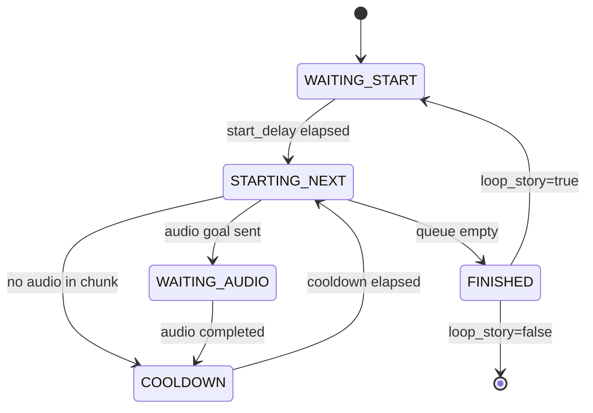

The `story_delivery` node autonomously delivers interactive narratives by coordinating speech synthesis, motor primitives, and facial animations from structured JSON story files.

## Node

- **Name**: `story_delivery`
- **Package**: `story_teller`
- **Entry point**: `story_teller.story_delivery:main`

## Architecture

The node follows a state-machine lifecycle:

## Topics

| Topic | Type | Direction | Description |
| --- | --- | --- | --- |
| `robot_speaking` | `std_msgs/Bool` | Publishes | `true` while robot is speaking, `false` otherwise |

## Actions Used

| Action | Type | Description |
| --- | --- | --- |
| `audio_play` | `AudioPlay` | Sends decoded WAV audio for playback |

## Parameters

| Parameter | Type | Default | Description |
| --- | --- | --- | --- |
| `story_filename` | `string` | `chunked.json` | Story JSON file to deliver |
| `start_delay` | `double` | `1.0` | Seconds to wait before starting delivery |
| `cooldown_seconds` | `double` | `1.0` | Pause between narrative chunks |
| `loop_story` | `bool` | `false` | Restart story after completion |
| `story_search_paths` | `string[]` | `/root/m_ws/src/story_teller/stories` | Directories to search for story files |
| `log_directory` | `string` | `~/.ella/logs` | Directory for session logs |
| `session_id` | `string` | `SESSION_ID` env var | Current session identifier |

## Story File Format

Stories are JSON documents containing an array of `NarrativeChunk` objects. Each chunk includes:

- **`content`** — Text content of the narrative segment
- **`audio_b64`** — Base64-encoded MP3 audio (decoded to WAV for playback)
- **`face_programs`** — Array of `[program_name, delay]` tuples for facial animations
- **`body_programs`** — Array of `[timeline_name, delay]` tuples for motor sequences

## Delivery Flow

1. Story JSON is loaded and parsed into a queue of `NarrativeChunk` objects
2. After `start_delay`, the first chunk is dequeued
3. Face and body animations are scheduled via `AnimationScheduler`
4. Audio is decoded from Base64 MP3 to WAV and sent to the `audio_play` action
5. On audio completion, a cooldown period elapses before the next chunk
6. When the queue is empty, the story either loops or finishes

## Dependencies

- `m_commons.animation.AnimationScheduler` — Coordinates face and body animations
- `m_commons.configuration.StoryManagerConfig` — Resolves story file paths
- `m_interfaces.action.AudioPlay` — Audio playback action client
