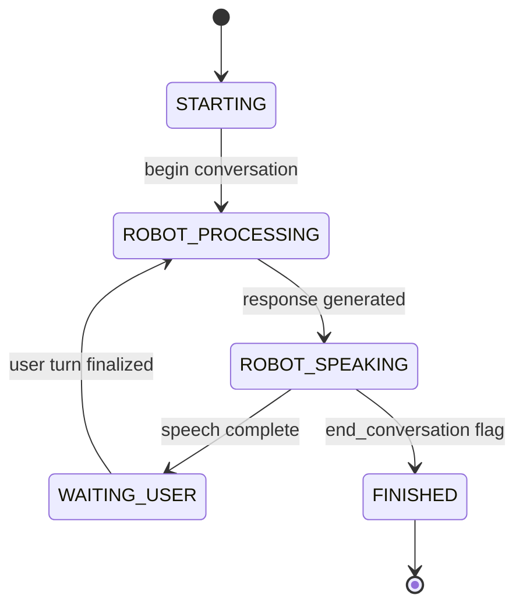

The `conversation_orchestrator` node manages two-way conversational coaching sessions for positive psychology, coordinating ASR input, LLM-based response generation, TTS output, and turn-taking.

## Node

- **Name**: `conversation_orchestrator`
- **Package**: `positivity_pysch_coach`
- **Entry point**: `positivity_pysch_coach.conversation_orchestrator:main`

## Architecture

The node follows a state-machine conversation lifecycle:



## Topics

| Topic | Type | Direction | Description |
| --- | --- | --- | --- |
| `asr_text` | `std_msgs/String` | Subscribes | Receives finalized ASR transcriptions |
| `robot_speaking` | `std_msgs/Bool` | Publishes | `true` while robot is speaking |

## Parameters

| Parameter | Type | Default | Description |
| --- | --- | --- | --- |
| `initial_wait_ms` | `double` | `5000.0` | Milliseconds to wait for initial ASR before prompting |
| `vad_silence_timeout_ms` | `double` | `1500.0` | Silence duration to finalize user turn |

## Internal Components

| Module | Class | Purpose |
| --- | --- | --- |
| `coach_response_generator` | `CoachResponseGenerator` | LLM-based response generation |
| `response_delivery` | `ResponseDelivery` | TTS synthesis and audio playback |
| `turn_manager` | `TurnManager` | Turn-taking with configurable timeouts |
| `session_tracker` | `SessionTracker` | Multi-day session tracking from config |
| `conversation_models` | `ConversationMemory`, `CoachReply` | Conversation state and reply models |

## LLM Integration

- **Model**: `openai/gpt-oss-120b` (configurable)
- **Session awareness**: Tracks multi-day sessions via `session_config.json`
- **Memory**: Maintains full conversation history for context-aware responses
- **End detection**: LLM signals `end_conversation` when the session should conclude

## Conversation Flow

1. Node starts and waits briefly before initiating the first robot turn
2. **Robot Processing** — LLM generates a response based on conversation memory
3. **Robot Speaking** — Response is delivered via TTS + audio playback
4. **Waiting User** — Turn manager monitors for ASR input with silence timeout
5. ASR text received during robot turns is buffered and carried forward
6. When user turn finalizes (silence timeout), the cycle repeats
7. If no user text is detected, the robot prompts the user

## ASR Buffering

The orchestrator handles ASR text arriving at any time:

- **During `WAITING_USER`** — Text is concatenated into the current user turn
- **During `ROBOT_PROCESSING` or `ROBOT_SPEAKING`** — Text is buffered as `pending_user_text` and carried forward to the next user turn
- **During `STARTING`** — Text is ignored (ambient noise)

## Launch

```bash
ros2 launch positivity_pysch_coach enhanced_conversation_interaction.launch.py
```
